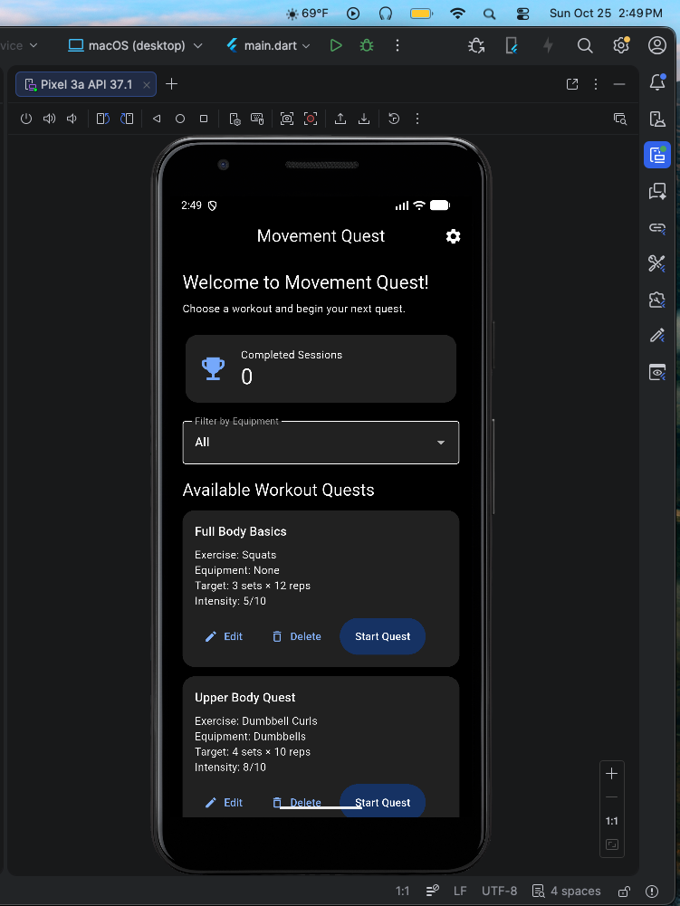
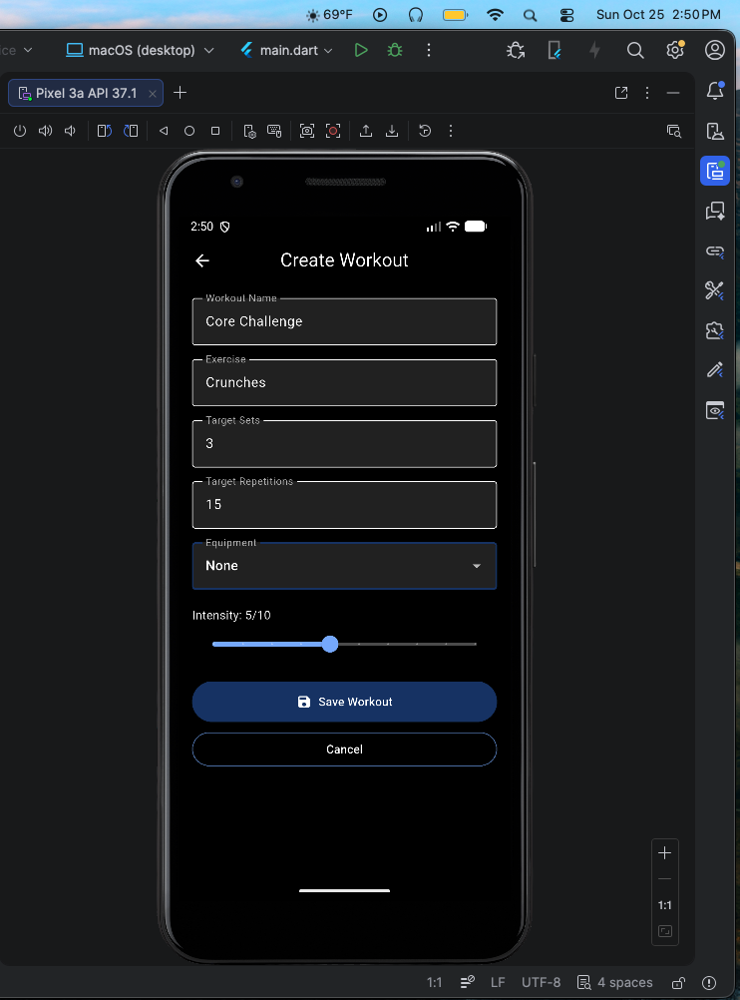
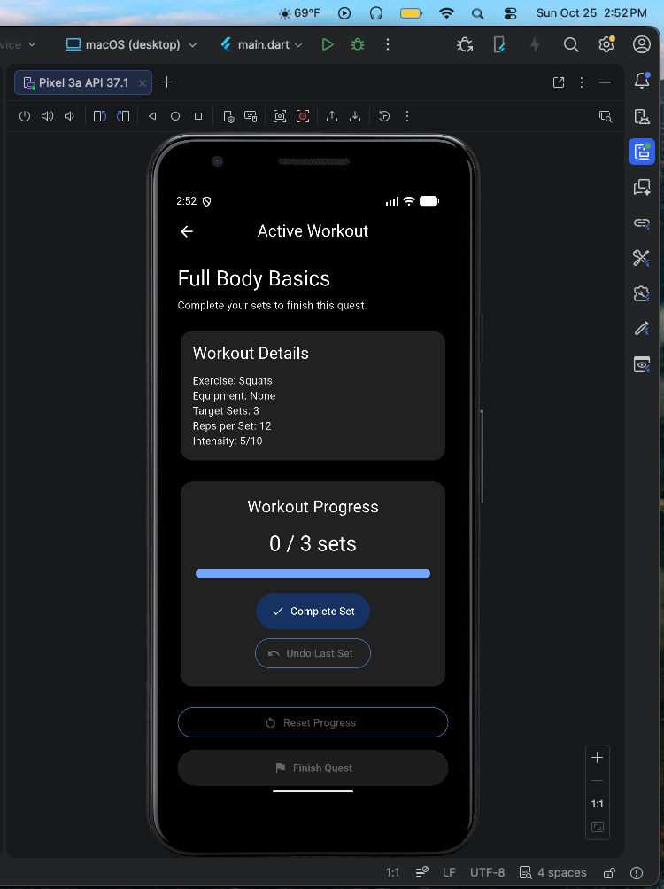
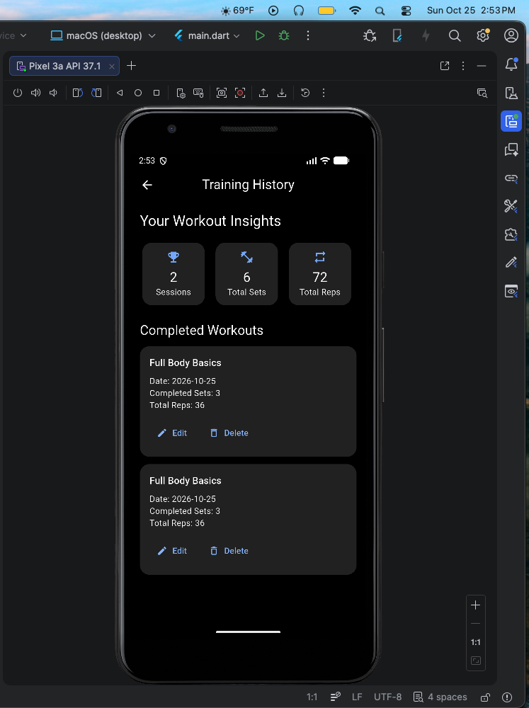
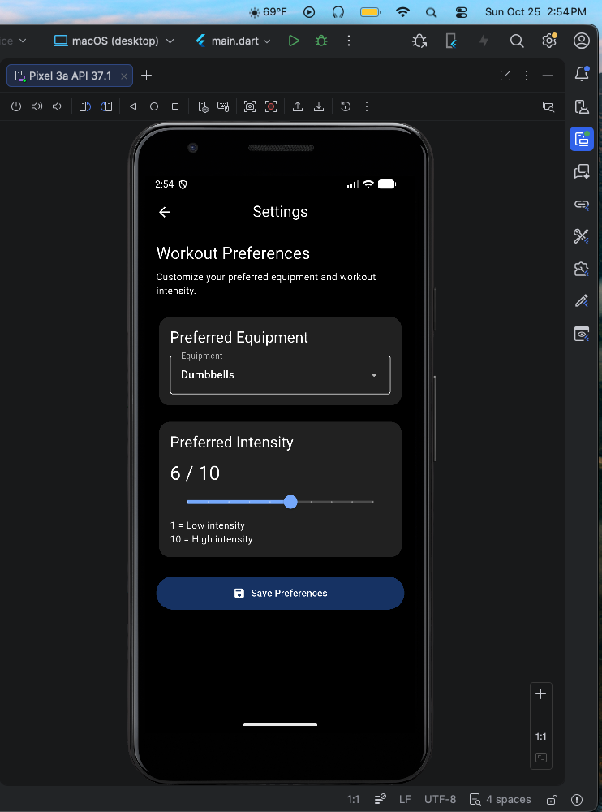
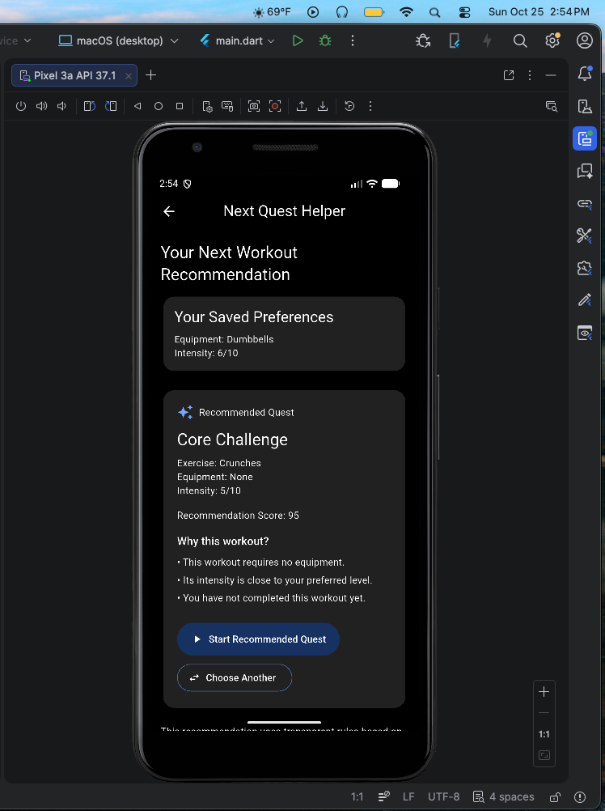

# Movement Quest

**Project 1 — Mobile Application Development**

**Developer:** Deborah Maignan  
**Pathway:** Undergraduate  
**Framework:** Flutter / Dart  
**Platform:** Android  
**Development Tools:** Visual Studio Code and Android Studio  

## Project Overview

Movement Quest is a Flutter-based workout planning and training log application designed to help users create workouts, track completed exercise sessions, and select their next workout.

The application provides a personalized Next Quest Recommendation Helper using transparent, rule-based scoring.

## Features

### 1. Workout Dashboard
- Displays saved workout plans.
- Filters workouts by equipment.
- Shows the number of completed training sessions.
- Provides navigation to workout creation, training history, settings, and recommendations.

### 2. Workout Management
- Create new workout plans.
- Edit existing workouts.
- Delete workouts with confirmation.
- Validate workout information, including sets, repetitions, and intensity.

### 3. Active Workout Sessions
- Start a selected workout.
- Record completed sets.
- Undo the last completed set.
- Reset session progress.
- Finish a workout and save its results.

### 4. Training History
- View previously completed workouts.
- Review total sessions, completed sets, and repetitions.
- Edit training records.
- Delete training records with confirmation.

### 5. Settings
- Select preferred equipment.
- Set preferred workout intensity.
- Preserve preferences after restarting the application.

### 6. Next Quest Recommendation Helper
- Recommends a workout based on equipment, intensity, training recency, and frequency.
- Displays a numerical recommendation score.
- Explains why a workout was selected.
- Allows users to override the recommendation.

The helper uses deterministic Dart rules rather than a trained machine-learning model.

## Technologies Used

| Technology | Purpose |
|---|---|
| Flutter | Cross-platform application framework |
| Dart | Application programming language |
| SQLite | Local workout and training-log storage |
| Android Studio | Android emulator management |
| Visual Studio Code | Development environment |

## Application Architecture

The application separates its functionality into models, screens, database operations, and recommendation services.

Important files include:

- `lib/main.dart` — application dashboard
- `lib/models/workout_plan.dart` — workout plan model
- `lib/models/training_log.dart` — training log model
- `lib/database/database_helper.dart` — SQLite database operations
- `lib/screens/workout_form_screen.dart` — workout creation and editing
- `lib/screens/active_workout_screen.dart` — active workout sessions
- `lib/screens/training_history_screen.dart` — training history
- `lib/screens/settings_screen.dart` — user preferences
- `lib/screens/recommendation_screen.dart` — workout recommendations
- `lib/services/next_quest_recommender.dart` — recommendation algorithm

## Database Design

Movement Quest uses two related SQLite tables:

**workout_plans**
- Stores workout names, exercises, equipment, sets, repetitions, and intensity.

**training_logs**
- Stores completed workout sessions, actual repetitions, completion dates, and reflections.

Each training log references a workout plan through `workout_plan_id`.

The database uses a foreign key with `ON DELETE CASCADE`, so deleting a workout also removes its associated training logs.

## Installation and Running the Application

1. Install Flutter, Dart, Android Studio, and the Android SDK.
2. Clone the GitHub repository.
3. Open the project folder in VS Code.
4. Start an Android emulator.
5. Run the following commands:

```bash
flutter pub get
flutter devices
flutter run
```

To run the automated tests:

```bash
flutter analyze
flutter test
```

## Screenshots

1. Workout Dashboard

2. Create or Edit Workout

3. Active Workout Session

4. Training History

5. Settings

6. Next Quest Recommendation


## Limitations and Future Improvements

- Workout recommendations use predefined scoring.
- Workout information is stored locally.
- Future improvements would be to have more detailed exercise tracking, expanded workout categories, and cloud synchronization.

## Attribution

The application was developed as part of my mobile application development course using Flutter and Dart.

AI assistance from Chatgpt

